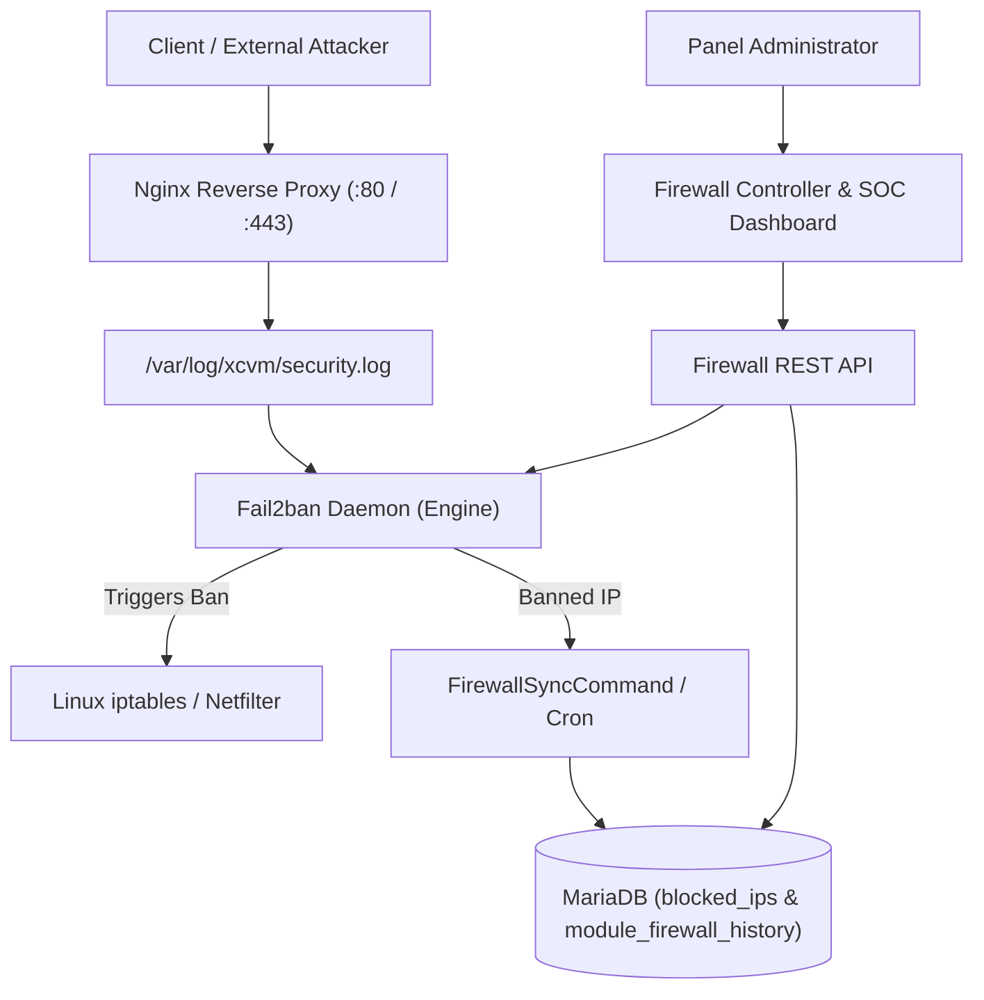
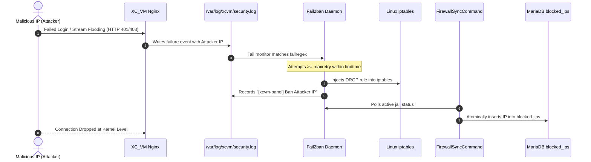

# XC_VM Firewall & Fail2ban Defense Suite

[](https://github.com/Rosmi720/Module_Firewall/releases)
[](https://php.net/)
[](https://github.com/Vateron-Media/XC_VM)
[](https://www.fail2ban.org/)
[](#design-aesthetics--zero-inline-css-policy)
[-brightgreen.svg)](#internationalization-i18n-engine)
[](#security-architecture--threat-model)
[](https://www.gnu.org/licenses/agpl-3.0.html)

A production-grade, enterprise-class **Security Operations Center (SOC) Firewall, Intrusion Prevention, and Dynamic Fail2ban Management Suite** built natively for the **XC_VM** IPTV management platform.

This module delivers automated brute-force protection, real-time IPTV stream anti-scraping, panel authentication hardening, custom regex filter compilation, cluster-wide ban synchronization, and live telemetry monitoring with **Zero Core Modifications** and **Zero Inline Styles**.

---

## Table of Contents

1. [Architectural Overview](#architectural-overview)
2. [Core Feature Matrix](#core-feature-matrix)
   - [Automated Fail2ban Defense Engine](#1-automated-fail2ban-defense-engine)
   - [Dynamic Security Rules Engine](#2-dynamic-security-rules-engine)
   - [Live Regex Compiler & Test Suite](#3-live-regex-compiler--test-suite)
   - [Security Presets (1-Click Optimization)](#4-security-presets-1-click-optimization)
   - [Executive SOC Live Radar & Telemetry Feed](#5-executive-soc-live-radar--telemetry-feed)
   - [Cluster Ban Synchronization & Manual Ban](#6-cluster-ban-synchronization--manual-ban)
   - [Universal Responsive DataTables](#7-universal-responsive-datatables)
3. [Architecture Diagrams & Data Flows](#architecture-diagrams--data-flows)
   - [Intrusion Detection & Auto-Ban Pipeline](#intrusion-detection--auto-ban-pipeline)
   - [Dynamic Filter Compilation & Deployment](#dynamic-filter-compilation--deployment)
4. [Security Architecture & Threat Model](#security-architecture--threat-model)
   - [Shell Execution Safety & Escaping](#shell-execution-safety--escaping)
   - [HTTP & Insecure Context Clipboard Fallback](#http--insecure-context-clipboard-fallback)
   - [Zero-Inline-CSS Strict Policy](#zero-inline-css-strict-policy)
   - [Multi-Tier Access Control (RBAC)](#multi-tier-access-control-rbac)
5. [Database Schema](#database-schema)
6. [CLI Automation & Cron Commands](#cli-automation--cron-commands)
7. [REST API Reference](#rest-api-reference)
8. [Installation & Deployment](#installation--deployment)
9. [Internationalization (i18n) Engine](#internationalization-i18n-engine)

---

## Architectural Overview

The Firewall Module operates strictly within the XC_VM modular monolith boundaries, ensuring clean encapsulation and zero core contamination:

- **Zero Core Modifications**: Routes, navigation, and console commands register via XC_VM provider contracts (`RouteProviderInterface`, `NavbarProviderInterface`, `CommandProviderInterface`, `CronProviderInterface`).
- **Database Isolation**: Resolves MySQL/MariaDB connections lazily through the `\XcVm\Infrastructure\Database\DatabaseAware` trait via `self::db()`, strictly avoiding `global $db`.
- **System Service Bridge**: Manages host `fail2ban-server`, `/etc/fail2ban/jail.d/`, and iptables with strict permission fallbacks (`0775`/`0664`) and multi-layer process validation.
- **Fail-Safe Design**: If Fail2ban is uninstalled or stopped, the web panel remains completely accessible and offers a 1-click installer and repair flow.



---

## Core Feature Matrix

### 1. Automated Fail2ban Defense Engine
- **Lifecycle Management**: Direct UI and CLI controls for service actions: `Start`, `Stop`, `Restart`, and `Reload`.
- **Real-Time Daemon Health**: Instant extraction of active Process ID (`PID`), engine uptime, and protected jail count.
- **Automated Host Setup**: 1-click self-installation of `fail2ban` and dependencies on Ubuntu (20.04/22.04/24.04) and Debian (11/12/13).

### 2. Dynamic Security Rules Engine
- **Core Default Jails**:
  - `xcvm-panel`: Protects administrative login endpoints against credential stuffing and brute-force attacks.
  - `xcvm-stream`: Detects unauthorized stream crawling, token manipulation, and aggressive connection flooding.
  - `sshd`: Hardens server SSH port (22) against automated dictionary attacks.
- **Custom Security Jails (Full CRUD)**:
  - Administrators can create custom rules for specific ports, protocols (`tcp`/`udp`), log files, and threshold limits (`maxretry`, `findtime`, `bantime`).
  - Rules can be enabled, disabled, edited, or deleted with instant table updates.
  - One-click **Reset Defaults** restoring core baseline protection rules safely.

### 3. Live Regex Compiler & Test Suite
- **Fail2ban Pattern Compiler**: Validates filter regex syntax before writing to disk.
- **Mandatory `<HOST>` Token Validation**: Enforces the presence of `<HOST>` in every failregex to guarantee proper IP capture by Fail2ban.
- **Interactive Regex Testing Modal**: Allows testing regex patterns directly against real sample log lines with visual match verification and captured IP extraction before deploying to production.

```mermaid
graph LR
    Input[User Regex Pattern] --> ValToken{Contains <HOST>?}
    ValToken -->|No| Reject[Validation Error]
    ValToken -->|Yes| TestModal[Live Test against Sample Log]
    TestModal -->|Success| Compile[Compile into /etc/fail2ban/filter.d/xcvm-{key}.conf]
    Compile --> DeployJail[Generate /etc/fail2ban/jail.d/xcvm-{key}.local]
    DeployJail --> Reload[Reload Fail2ban Engine]
```

### 4. Security Presets (1-Click Optimization)
Quickly switch the entire server defense posture without manually tweaking numerical thresholds:
- **Balanced (Default)**: `maxretry=5`, `findtime=10m`, `bantime=1h`. Recommended for standard multi-user IPTV installations.
- **Strict**: `maxretry=3`, `findtime=30m`, `bantime=24h`. Recommended during suspicious traffic waves or targeted credential scans.
- **Aggressive**: `maxretry=2`, `findtime=1h`, `bantime=7 days`. Maximum deterrence against persistent attackers and botnets.
- **Custom**: Preserves custom, fine-tuned configurations.

### 5. Executive SOC Live Radar & Telemetry Feed
- **High-Tech SOC Radar Pill**:
  - Rotating radar beacon (`ti tabler-radar`) with animated ripple ping rings (`@keyframes fw-soc-radar-ping`).
  - Seamless toggle on click with zero delay.
  - State persistence in browser `localStorage`.
- **Live Heartbeat Polling**:
  - Polls telemetry metrics every 10 seconds: Active Banned IPs, Failed Attempts, Cluster Blocks, and Engine Health.
  - Emits an animated flash heartbeat on successful telemetry reception.
- **Live Stream Viewers**:
  - Embedded real-time feeds for `/var/log/fail2ban.log` and `/var/log/xcvm/security.log`.

### 6. Cluster Ban Synchronization & Manual Ban
- **Bi-Directional Database Sync**:
  - Synchronizes active kernel/Fail2ban bans into the database (`firewall_banned_ips` and core `blocked_ips`).
  - Runs automatically every 5 minutes via `FirewallCronJob` (`cron:firewall_sync`).
- **Instant Unban Capability**:
  - Unban any IP address directly from the UI or CLI. Immediately executes `fail2ban-client set {jail} unbanip {ip}` and flushes database ban flags.
- **Manual Ban Modal**:
  - Manually blacklist any offending IPv4/IPv6 or CIDR block, select the target jail, specify duration, and record the administrative reason.

### 7. Universal Responsive DataTables
All 4 data tables in the module feature responsive collapsing and full export toolbars:
- `#rulesTable`: Filterable by category (`All`, `Core Defaults`, `Custom Rules`).
- `#bannedTable`: Real-time banned IP monitor with quick unban actions.
- `#historyTable`: Full historical audit log of BAN/UNBAN events.
- `#cliTable`: Interactive terminal commands reference table with 1-click copy buttons.
- **Export Toolbar**: `Copy`, `CSV`, `Excel`, `PDF`, and `Print`.

### 8. First-Time Setup Wizard (Automated Onboarding)
- **Automatic Guided Launch**: Automatically launches upon first dashboard access after module installation if Fail2ban is unconfigured or not marked complete.
- **Auto-Detected Safe Whitelist**: Automatically detects the server IP and the administrator's current public/remote IP, prepopulating `ignoreip` to prevent accidental administrator lockouts.
- **3-Step Guided Provisioning**:
  1. Engine & Version Compatibility Check.
  2. Preset Profile Selection & Whitelist Hardening.
  3. One-Click Deployment, Rule Compilation, and Service Start.

### 9. Upstream Version Inspector & Package Upgrade
- **Tri-Fold Version Analysis**: Real-time comparison between:
  1. Locally installed Fail2ban version (e.g. `1.0.2`).
  2. Operating system distribution APT package candidate (e.g. `1.0.2-3ubuntu0.1`).
  3. Official Upstream GitHub Release (e.g. `1.1.1` via GitHub API with 6-hour caching).
- **Outdated Engine Detection**: Automatically highlights update status in the Executive Hero Bar and Version Inspector modal.
- **Unattended Package Upgrade**: 1-click package upgrade via web API or terminal (`php console.php firewall upgrade`).

---

## Architecture Diagrams & Data Flows

### Intrusion Detection & Auto-Ban Pipeline



---

## Security Architecture & Threat Model

### Shell Execution Safety & Escaping
All commands interacting with `fail2ban-client`, `fail2ban-server`, `systemctl`, and `iptables` adhere to strict security constraints:
- **No Direct Shell Interpolation**: All dynamic variables (IPs, jail names, file paths) are passed through `escapeshellarg()`.
- **Strict Input Whitelisting**: Actions (`start`, `stop`, `restart`, `reload`, `status`, `unban`, `ban`) are checked against strict enumeration whitelists before execution.
- **IP Address Sanitization**: IPs are validated against `filter_var($ip, FILTER_VALIDATE_IP)`.

### HTTP & Insecure Context Clipboard Fallback
Standard `navigator.clipboard.writeText()` is restricted by browser security policies to HTTPS or `localhost`.
When administrators manage XC_VM via direct server IP over HTTP (`http://ip:port/`), naive clipboard implementations crash with `TypeError: Cannot read properties of undefined (reading 'writeText')`.
The Firewall Module implements a **Universal Dual-Mode Clipboard Helper**:
1. Checks `if (navigator.clipboard && window.isSecureContext)`.
2. Falls back automatically to an off-screen `document.execCommand('copy')` textarea mechanism.
3. Provides graceful fallback notifications if permissions are disabled.

### Zero-Inline-CSS Strict Policy
- **Zero `style="..."` attributes** in any view file (`dashboard.php`, `rules.php`, `settings.php`, `logs.php`, `scripts.php`).
- 100% of custom styles, radar animations, and badge layouts live in [views/firewall.css](file:///home/xc_vm/Modules/firewall_d8578/views/firewall.css).
- Fully compatible with Bootstrap 5 design tokens and Sneat / Vuexy light and dark themes.

---

## Database Schema

The module owns and manages three dedicated tables in the XC_VM MariaDB database:

```sql
-- Module Configuration Store
CREATE TABLE IF NOT EXISTS `module_firewall_settings` (
    `key` VARCHAR(64) NOT NULL PRIMARY KEY,
    `value` TEXT NOT NULL,
    `updated_at` INT UNSIGNED NOT NULL
) ENGINE=InnoDB DEFAULT CHARSET=utf8mb4;

-- Historical Ban/Unban Audit Log
CREATE TABLE IF NOT EXISTS `module_firewall_history` (
    `id` INT UNSIGNED NOT NULL AUTO_INCREMENT PRIMARY KEY,
    `ip` VARCHAR(45) NOT NULL,
    `jail` VARCHAR(32) NOT NULL,
    `action` ENUM('BAN', 'UNBAN') NOT NULL,
    `reason` VARCHAR(255) NULL,
    `date` INT UNSIGNED NOT NULL,
    INDEX `idx_ip` (`ip`),
    INDEX `idx_date` (`date`)
) ENGINE=InnoDB DEFAULT CHARSET=utf8mb4;

-- Dynamic Fail2ban Rules & Jails Configuration
CREATE TABLE IF NOT EXISTS `module_firewall_rules` (
    `id` INT UNSIGNED NOT NULL AUTO_INCREMENT PRIMARY KEY,
    `rule_key` VARCHAR(64) NOT NULL UNIQUE,
    `name` VARCHAR(128) NOT NULL,
    `category` ENUM('default', 'custom') NOT NULL DEFAULT 'custom',
    `enabled` TINYINT(1) NOT NULL DEFAULT 1,
    `port` VARCHAR(128) NOT NULL DEFAULT 'all',
    `protocol` VARCHAR(16) NOT NULL DEFAULT 'tcp',
    `filter_regex` TEXT NULL,
    `log_path` VARCHAR(255) NULL,
    `maxretry` INT UNSIGNED NOT NULL DEFAULT 5,
    `findtime` INT UNSIGNED NOT NULL DEFAULT 600,
    `bantime` INT UNSIGNED NOT NULL DEFAULT 3600,
    `action_type` VARCHAR(64) NOT NULL DEFAULT 'iptables-multiport',
    `description` TEXT NULL,
    `created_at` INT UNSIGNED NOT NULL,
    `updated_at` INT UNSIGNED NOT NULL,
    INDEX `idx_category` (`category`),
    INDEX `idx_enabled` (`enabled`)
) ENGINE=InnoDB DEFAULT CHARSET=utf8mb4;
```

---

## CLI Automation & Cron Commands

All module operations are fully accessible via the XC_VM console runner (`console.php`):

| Command | Arguments | Description |
| :--- | :--- | :--- |
| `php console.php firewall:manage status` | None | Displays real-time Fail2ban daemon status, PID, uptime, and active jail bans. |
| `php console.php firewall:manage start` | None | Starts the `fail2ban-server` process. |
| `php console.php firewall:manage stop` | None | Stops the `fail2ban-server` process safely. |
| `php console.php firewall:manage restart` | None | Restarts the Fail2ban daemon and reloads filters. |
| `php console.php firewall:manage reload` | None | Reloads jail configurations without dropping existing bans. |
| `php console.php firewall:manage deploy` | None | Compiles and writes filter and jail `.local` files to `/etc/fail2ban/`. |
| `php console.php firewall:manage install` | None | Automatically installs `fail2ban` packages via apt. |
| `php console.php firewall:manage sync` | None | Synchronizes active jail bans to MariaDB. |
| `php console.php firewall:manage unban <ip>` | `<ip>` | Unbans an IP address from all active jails immediately. |
| `php console.php firewall:manage ban <ip> [jail]` | `<ip> [jail]` | Manually bans an IP address in the specified jail. |
| `php console.php firewall:sync` | None | Dedicated high-speed cron synchronizer. |

---

## REST API Reference

All endpoints are authenticated and accessible via the panel API controller:

```
POST /{accessCode}/api?action={action}
```

| API Action | Parameters | Description |
| :--- | :--- | :--- |
| `firewall_get_status` | None | Returns JSON containing engine status, uptime, PID, and jail summaries. |
| `firewall_get_monitor` | None | Returns real-time metrics, feeds, and telemetry for SOC live monitoring. |
| `firewall_service_control`| `service_action` (`start`\|`stop`\|`restart`\|`reload`) | Executes service lifecycle operation. |
| `firewall_deploy` | None | Compiles all active database rules and writes configuration files. |
| `firewall_sync` | None | Triggers bi-directional kernel-to-database ban synchronization. |
| `firewall_install` | None | Triggers host automated Fail2ban package installation. |
| `firewall_save_settings` | `security_preset`, `custom_maxretry`, `custom_bantime`, `custom_findtime`, `whitelist_ips` | Saves security preset and updates global thresholds. |
| `firewall_unban` | `ip`, `jail` | Releases IP from netfilter and updates database status. |
| `firewall_ban` | `ip`, `jail`, `reason` | Manually blacklists an IP address. |
| `firewall_get_logs` | `type` (`security`\|`fail2ban`), `lines` | Returns tail output of system security log streams. |
| `firewall_get_rules` | None | Returns list of all defined security rules. |
| `firewall_save_rule` | `rule_key`, `name`, `port`, `protocol`, `filter_regex`, `log_path`, `maxretry`, `findtime`, `bantime`, `description` | Creates or updates a security rule. |
| `firewall_delete_rule` | `rule_key` | Deletes a custom rule and removes its configuration files. |
| `firewall_toggle_rule` | `rule_key`, `enabled` | Enables or disables an enforcement rule. |
| `firewall_reset_default_rules`| None | Re-seeds default security rules. |
| `firewall_test_regex` | `regex`, `sample_log` | Validates and tests regex pattern against sample log text. |

---

## Installation & Deployment

### Method 1: Web Admin Upload (.zip)
1. Download `firewall_v1.0.0.zip` from the [Latest Release](https://github.com/Rosmi720/Module_Firewall/releases).
2. Log in to your **XC_VM Admin Panel**.
3. Navigate to **Settings → Modules → Upload Module**.
4. Select `firewall_v1.0.0.zip` and click **Upload & Install**.
5. The module automatically registers database tables, configures default jails, and adds the **Firewall & Fail2ban** menu under the navigation bar.

### Method 2: Manual Server Deployment
1. Clone or extract the repository directly into your modules directory:
   ```bash
   git clone https://github.com/Rosmi720/Module_Firewall.git /home/xc_vm/Modules/firewall
   ```
2. Enable the module in `/home/xc_vm/config/modules.php`:
   ```php
   'firewall' => [
       'enabled' => true,
       'class' => \XcVm\Module\Firewall\FirewallModule::class,
   ],
   ```
3. Initialize tables and deploy configurations:
   ```bash
   php /home/xc_vm/console.php firewall:manage install
   php /home/xc_vm/console.php firewall:manage deploy
   php /home/xc_vm/console.php firewall:manage start
   ```

---

## Internationalization (i18n) Engine

The module features seamless multi-language support powered by `FirewallTranslator`:
- **English (`en.ini`)**: Complete standard dictionary.
- **Arabic (`ar.ini`)**: Native Arabic translations with complete RTL layout optimization.
- **Zero-Core Reflection**: Dynamically merges module translations into the global `\XcVm\Core\Localization\Translator` without modifying core translation files.

---

## License

This module is licensed under the **GNU Affero General Public License v3.0 (AGPL-3.0)**.  
Built for the **XC_VM** Open-Source IPTV Community.
